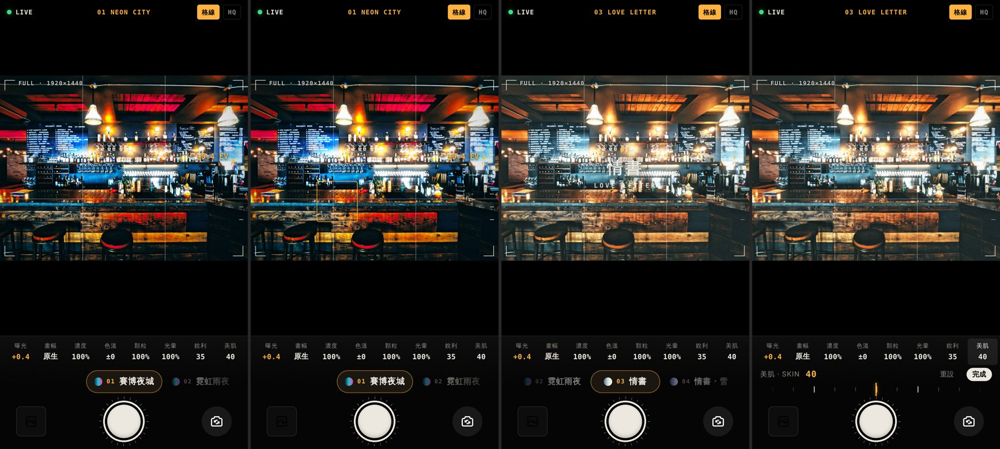
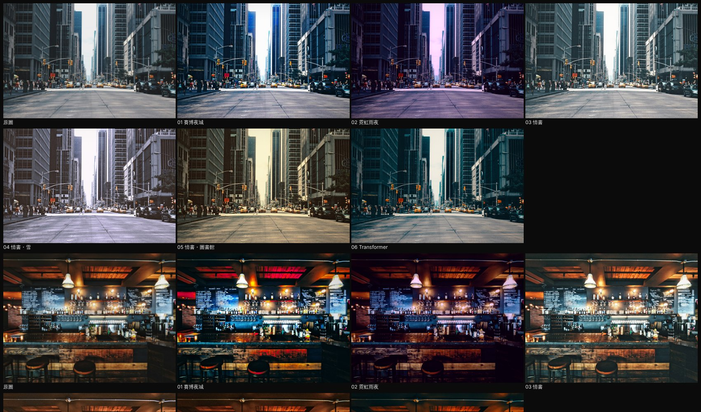

# EIGACAM · 一拍入戲

手機上的電影調色相機。取景時就看到調色後的畫面。按下快門後，照片以感光元件可提供的最高解析度沖印到「底片盒」，再由你存進相簿。

開啟：https://bbcode1111.github.io/eigacam/ （可在手機瀏覽器「加入主畫面」）

**EIGASTUDIO**（照片調色工作室：整包匯入 .xmp 調色預設與 LUT、挑色、遮色片）在 `dist/eigastudio/`，說明見 [docs/eigastudio.md](docs/eigastudio.md)。



## 拍攝

- **取景器**：顯示調色後的即時畫面。**左右滑**換色彩、**右半邊上下拖**調曝光（右側出現曝光尺）、**左半邊上下拖**調濾鏡濃度（左側出現濃度尺）、**點一下**對焦（裝置支援時會真的對焦測光）；右上「格線」開關三分構圖線。
- **室內模式**（右上「室內」）：依畫面平均亮度自動補光（最多約 +1.4 EV）、提亮暗部、減少燈光的黃綠色偏。室內顏色暗沉時打開。
- **柔焦與底片感**：情書、圖書館有擴散濾鏡式的柔焦，光會在畫面上暈開，環境帶底片顆粒；人物上的柔焦和顆粒都減輕，所以人是清晰的。「光暈」可以調柔焦強弱。
- **色彩視窗**：轉輪左邊的彩色方塊，或點上方的色彩名稱。所有色彩依系列分組成卡片，縮圖是用眼前的畫面即時算出來的。右上「匯入」可以加入 `.cube` LUT 或 Lightroom `.xmp` 預設（近似換算，最多 24 個），匯入的可以在卡片上刪除。
- **拍攝模式**（參數列「模式」）：
  - 重曝 2×：拍第一張後畫面會留下半透明疊影，對好位置再拍第二張，兩次曝光平均疊成一張。
  - 慢門 1 秒／4 秒：快門開著的期間把畫面平均起來，移動的東西會化成絲。
  - 光軌 4 秒：每個像素保留最亮的值，車燈和霓虹會拉成線。
  - 倒數 3 秒。
  - 慢門與光軌的輸出長邊上限 2560px；需要拿穩或用腳架。
- **不會疊兩層濾鏡**：沖印出來的 JPEG 帶一個小標記。把 EIGACAM 拍過的照片再匯入時，如果原始檔還在底片盒，會直接改用原始檔；不在的話會先提醒。在照片頁用「換色彩」一律是從原始檔重新沖印。
- **色彩轉輪**：快門上方的一排色彩，轉到中間就選中，像鏡頭上的環。電腦上可以用滑鼠拖曳或滾輪轉動。
- **CAM／STUDIO**：左上角切換到 EIGASTUDIO（匯入風格、曲線、遮色片、批次調色）。
- **流暢度**：取景畫面變慢時（低於約 20 fps）會自動降低預覽解析度；拍下來的照片仍是全解析度。
- **HUD**：顯示待機／即時／拍攝狀態、目前色彩，以及感光元件解析度。
- **畫幅**：原生、16:9、1.85、2.39 寬銀幕。照片依照片方向裁切，直拍時是直式畫幅；要拍橫向寬銀幕，請橫拿手機。
- **美肌**（參數列「美肌」，預設 40）：自動偵測膚色，只在皮膚上做保留邊緣的磨皮，眼睛、眉毛、頭髮、鏡框維持銳利；皮膚上的底片顆粒也會減少。
- **膚色獨立渲染與光影強調**：環境照電影色彩調色，皮膚保留乾淨、帶一點紅潤的原色，只沾一點氛圍；大範圍的光影（dodge & burn）讓明暗層次更立體，臉上會比較輕。
- **參數轉盤**：曝光、濃度（色彩強度）、亮部、暗部、色溫、顆粒、光暈、銳利。光暈的預設值每個色彩不同（賽博夜城、霓虹雨夜 40%，Transformer 30%），你調過的值會依色彩各自記住。拖曳刻度尺調整，按「重設」回到預設值。
- **HQ**：開啟後，快門會打開系統相機。用系統相機拍攝畫質最高（iPhone 也能拿到原生 12MP 以上的照片），拍完回到這裡自動沖印。
- **變焦**：裝置支援時，取景器下方會出現 1×／2×／3× 等選項。
- **底片盒**：所有照片都先保存在這台裝置。可以一次選多張、一次分享或儲存；也可以從原始檔換一種色彩重新沖印。照片頁的「編輯參數」會用原始檔在 EIGASTUDIO 打開，帶入拍攝時的色彩與參數，可以再調曲線、亮暗部與遮色片。
- **遮色片工作室**：參數列最後的「遮色片」。在取景器上即時看到效果；沒開相機時用最近一張照片預覽。
  - 四種選取：**漸層**（拖兩個點）、**圓形**（拖中心與邊緣）、**明暗範圍**、**顏色範圍**，最多 8 個。
  - 每個遮色片有自己的曝光、色溫、色調、飽和、對比與染色。
  - **複製**、**複製並反轉**（例如：圓形提亮人物 → 複製並反轉 → 背景壓暗）、反轉、停用、「顯示範圍」用紅色標出選到的地方。
  - 「另存配方」會以目前色彩為底、加上這些遮色片，存成新的配方（R1、R2…），出現在色彩列表最後；拍照、匯入、重新沖印都會套用。
- **匯入**：相簿照片（JPEG、HEIC、PNG、WebP）可以匯入沖印，也可以匯入 `.cube` 3D LUT 當作自訂色彩。

## 色彩



| 代號 | 名稱 | 方向 |
|---|---|---|
| 01 | 賽博夜城 NEON CITY | 霓虹放到最大：招牌與燈光的青、藍、洋紅又濃又亮還會暈開，夜色是帶青的深黑；膚色另外渲染，維持正常 |
| 02 | 霓虹雨夜 NEON RAIN | 依照網友分享的 Lightroom 賽博龐克參數：紫色陰影、洋紅高光、青藍霓虹 |
| 03 | 情書 LOVE LETTER | 日系的清亮：偏亮、空氣透明、乾淨的奶白，綠與藍清爽，暗部帶一點青；膚色明亮紅潤 |
| 04 | 情書・雪 LOVE LETTER · SNOW | 濛濛的暖底色加上遮色片：淡藍紫冷光、雪白亮部，「膚色保護」讓臉保持溫暖 |
| 05 | 情書・圖書館 LOVE LETTER · LIBRARY | 鎢絲燈的暖金色包住畫面，顏色還在、不混濁，暗部是溫暖的深褐 |
| 06 | Transformer TEAL · ORANGE | 好萊塢大片的青橙對比（《變形金剛》、《瘋狂麥斯：憤怒道》這類）：天空和陰影偏青藍，受光面、膚色、沙土偏暖橙金；中等對比，暗部留細節、高光不過曝 |

04、05 是用**遮色片（局部調整）**做的變化：漸層、圓形、明暗範圍、顏色範圍四種選取方式，每個遮色片有自己的曝光、色溫、色調、飽和、對比與染色，可以複製、反轉後再調整。

色彩是創作詮釋，不是任何電影、遊戲或片商的官方 LUT。也可以匯入自己的 `.cube` LUT。

02 用的是 Lightroom 參數模式（`lr`）：在 `dist/src/looks.js` 填入 Lightroom 的基本、HSL、顏色分級與去朦朧數值，就能建立新風格。這是近似換算，因為 Lightroom 處理的是 RAW，手機照片已經套過相機的色調。

Lightroom 預設檔：[`presets/EIGACAM-Neon-Rain.xmp`](https://bbcode1111.github.io/eigacam/presets/EIGACAM-Neon-Rain.xmp)。在 Lightroom 行動版選「預設集 → ⋯ → 匯入預設集」，桌面版用「預設集 ＋ → 匯入預設集」。白平衡是相對調整（色溫 −22、色調 +25），適用 JPEG/HEIC；RAW 檔請手動把色溫調冷一些、色調往洋紅。

## 畫質

- 相機會要求完整 4:3 感光元件（最高 4032×3024）。如果瀏覽器先開了較小的模式，會再依照相機回報的能力提高解析度。
- Android Chrome 會用 ImageCapture 拍真正的靜態照片；其他瀏覽器保存全解析度的取景影格，不是縮小過的預覽。
- iPhone 的網頁相機只能拿到錄影影格，畫質不如原生相機。要最清晰的照片，請開 **HQ**。
- 調色流程：sRGB → 線性光 → 曝光與白平衡 → 只作用在亮度的銳利化（有限幅，不產生白邊）→ 光暈與底片暈光 → 33³ 3D LUT → 顆粒 → JPEG 94%。手機最高輸出約 12.6MP，桌面最高 40MP。
- 每種色彩都由 `dist/src/color.js` 的色彩模型產生：在 OKLab/OKLCh 做色相與飽和調整、分離色調、高光與陰影去飽和、底片式 S 曲線與高光肩部、拷貝片的各通道色偏，再烘焙成 3D LUT。

## 開發

無須建置或安裝套件，網站位於 `dist/`。

```sh
python3 -m http.server 8766   # 開啟 http://localhost:8766/dist/
node --test tests/*.test.mjs
```

瀏覽器驗證頁：`/tests/looks.html`（所有色彩在範例照片上的實際輸出）、`/tests/masks.html`（遮色片與「顯示範圍」）、`/tests/develop.html?img=street&look=nightcity`（全解析度沖印）。

推送到 `main` 後，GitHub Actions 會先跑測試，再把 `dist/` 部署到 GitHub Pages。

## 限制

- 需要 WebGL2；相機需要 HTTPS 和使用者授權，不會使用麥克風。
- 照片保存在瀏覽器的裝置儲存空間。清除網站資料就會刪除照片，請記得存到相簿。
- 尚未支援影片與 RAW。不同裝置的螢幕色彩可能略有差異。

介面圖示使用 Tabler Icons（MIT，授權位於 `dist/assets/icons/LICENSE`）。範例照片來自 Unsplash。

## KIRINOMA 暮色（2026-11-13）

新增 07 暮色原味、08 暖膚日光、09 冷青夜色，以使用者提供的 #LC 暮色夢境 XMP 基礎加色感 1／22／37 為出發點，可即時取景、匯入與重新沖印。

舊版偏色彩增強、冷暖分離、深黑位及強膚色還原；本包基礎是高光 −41、陰影 +62、白色 −77、黑色 +73，逐色壓飽和（色感 1 綠色 −77），主曲線把黑點抬到 58/255、白點降至 211/255，並有 RGB 曲線、相機校正及明度範圍負清晰度。因此單加金色暈光無法重現。

新增不等距 XMP 曲線插值，保留三組主曲線與 RGB 節點。針對已處理的 sRGB 手機照片，曲線分別混合 65%、48%、72%，避免照搬 RAW 參數令中間調過暗。暖膚／冷青是改編名稱。收斂光暈、膚色還原降至 12%，以明度範圍降低局部反差，保留微量紋理及顆粒。

限制：不是 Adobe 引擎逐像素重製。Adobe Color、相機校正（紅 +30／綠 +80／藍 −10）、內嵌壓縮濾鏡、降噪與精確遮罩未解碼或移植。Basic／HSL／grading、負清晰度和顆粒均為近似。原檔未指定拍攝曝光與白平衡，現場光源仍會影響結果。
