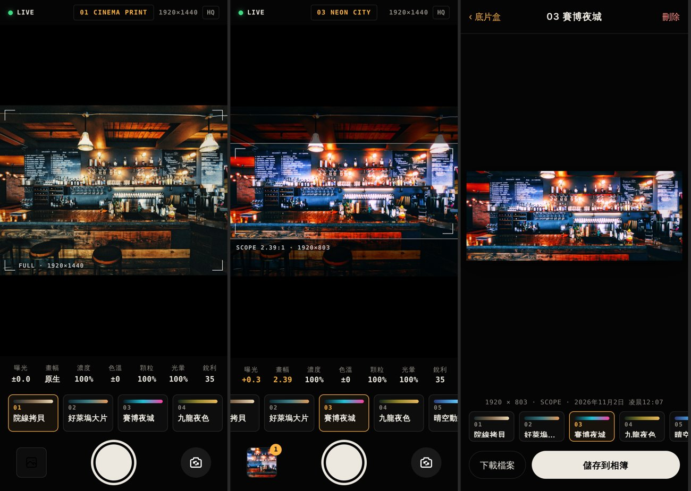
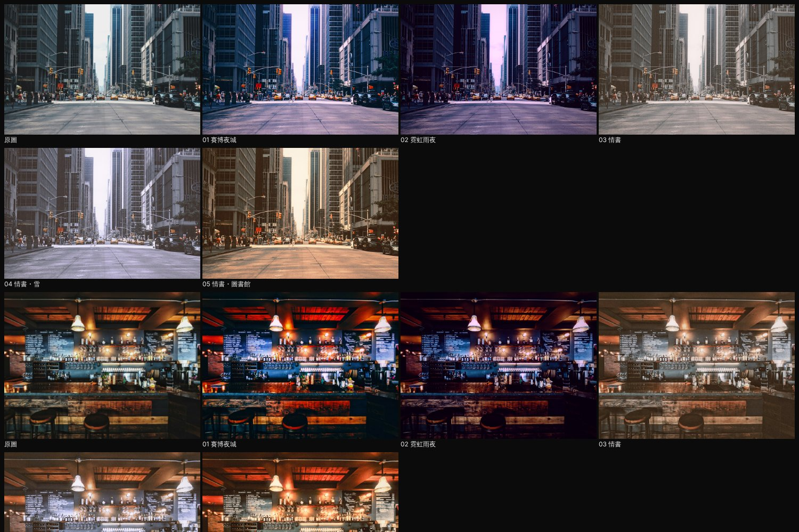

# EIGACAM · 一拍入戲

手機上的電影調色相機。取景時就看到調色後的畫面。按下快門後，照片以感光元件可提供的最高解析度沖印到「底片盒」，再由你存進相簿。

開啟：https://bbcode1111.github.io/eigacam/ （可在手機瀏覽器「加入主畫面」）



## 拍攝

- **取景器**：顯示調色後的即時畫面，有畫幅框線與遮幅，左右滑動可換色彩。
- **HUD**：顯示待機／即時／拍攝狀態、目前色彩，以及感光元件解析度。
- **畫幅**：原生、16:9、1.85、2.39 寬銀幕。照片依照片方向裁切，直拍時是直式畫幅；要拍橫向寬銀幕，請橫拿手機。
- **參數轉盤**：曝光、濃度（色彩強度）、色溫、顆粒、光暈、銳利。拖曳刻度尺調整，按「重設」回到預設值。
- **HQ**：開啟後，快門會打開系統相機。用系統相機拍攝畫質最高（iPhone 也能拿到原生 12MP 以上的照片），拍完回到這裡自動沖印。
- **變焦**：裝置支援時，取景器下方會出現 1×／2×／3× 等選項。
- **底片盒**：所有照片都先保存在這台裝置。可以一次選多張、一次分享或儲存；也可以從原始檔換一種色彩重新沖印。
- **匯入**：相簿照片（JPEG、HEIC、PNG、WebP）可以匯入沖印，也可以匯入 `.cube` 3D LUT 當作自訂色彩。

## 色彩



| 代號 | 名稱 | 方向 |
|---|---|---|
| 01 | 賽博夜城 NEON CITY | 青藍暗部、洋紅霓虹與光暈，高飽和、深黑（Cyberpunk 2077 印象） |
| 02 | 霓虹雨夜 NEON RAIN | 依照網友分享的 Lightroom 賽博龐克參數：紫色陰影、洋紅高光、青藍霓虹 |
| 03 | 情書 LOVE LETTER | 對照電影畫面實測調出：暖米色中間調、褐色微亮的黑、帶粉紫的白、低飽和、濛濛的光暈；膚色、臉頰、嘴唇保有血色 |
| 04 | 情書・雪 LOVE LETTER · SNOW | 情書的底色加上遮色片：淡藍紫冷光、雪白亮部，另有「膚色保護」遮色片讓臉保持溫暖 |
| 05 | 情書・圖書館 LOVE LETTER · LIBRARY | 情書的底色加上遮色片：鎢絲燈琥珀橘、亮部暖光暈、暗部沉下去 |

04、05 是用**遮色片（局部調整）**做的變化：漸層、圓形、明暗範圍、顏色範圍四種選取方式，每個遮色片有自己的曝光、色溫、色調、飽和、對比與染色，可以複製、反轉後再調整。

色彩是創作詮釋，不是任何電影、遊戲或片商的官方 LUT。也可以匯入自己的 `.cube` LUT。

02 用的是 Lightroom 參數模式（`lr`）：在 `dist/src/looks.js` 填入 Lightroom 的基本、HSL、顏色分級與去朦朧數值，就能建立新風格。這是近似換算，因為 Lightroom 處理的是 RAW，手機照片已經套過相機的色調。

Lightroom 預設檔：[`presets/EIGACAM-Neon-Rain.xmp`](https://bbcode1111.github.io/eigacam/presets/EIGACAM-Neon-Rain.xmp)。在 Lightroom 行動版選「預設集 → ⋯ → 匯入預設集」，桌面版用「預設集 ＋ → 匯入預設集」。白平衡是相對調整（色溫 −22、色調 +25），適用 JPEG/HEIC；RAW 檔請手動把色溫調冷一些、色調往洋紅。

## 畫質

- 相機會要求完整 4:3 感光元件（最高 4032×3024）。如果瀏覽器先開了較小的模式，會再依照相機回報的能力提高解析度。
- Android Chrome 會用 ImageCapture 拍真正的靜態照片；其他瀏覽器保存全解析度的取景影格，不是縮小過的預覽。
- iPhone 的網頁相機只能拿到錄影影格，畫質不如原生相機。要最清晰的照片，請開 **HQ**。
- 調色流程：sRGB → 線性光 → 曝光與白平衡 → 只作用在亮度的銳利化（有限幅，不產生白邊）→ 光暈與底片暈光 → 33³ 3D LUT → 顆粒 → JPEG 94%。手機最高輸出約 12.6MP，桌面最高 40MP。
- 每種色彩都由 `dist/src/color.js` 的色彩模型產生：在 OKLab/OKLCh 做色相與飽和調整、分離色調、高光與陰影去飽和、底片式 S 曲線與高光肩部、拷貝片的各通道色偏，再烘焙成 3D LUT。

## 開發

無須建置或安裝套件，網站位於 `dist/`。

```sh
python3 -m http.server 8766   # 開啟 http://localhost:8766/dist/
node --test tests/*.test.mjs
```

瀏覽器驗證頁：`/tests/looks.html`（所有色彩在範例照片上的實際輸出）、`/tests/develop.html?img=street&look=nightcity`（全解析度沖印）。

推送到 `main` 後，GitHub Actions 會先跑測試，再把 `dist/` 部署到 GitHub Pages。

## 限制

- 需要 WebGL2；相機需要 HTTPS 和使用者授權，不會使用麥克風。
- 照片保存在瀏覽器的裝置儲存空間。清除網站資料就會刪除照片，請記得存到相簿。
- 尚未支援影片與 RAW。不同裝置的螢幕色彩可能略有差異。

介面圖示使用 Tabler Icons（MIT，授權位於 `dist/assets/icons/LICENSE`）。範例照片來自 Unsplash。
