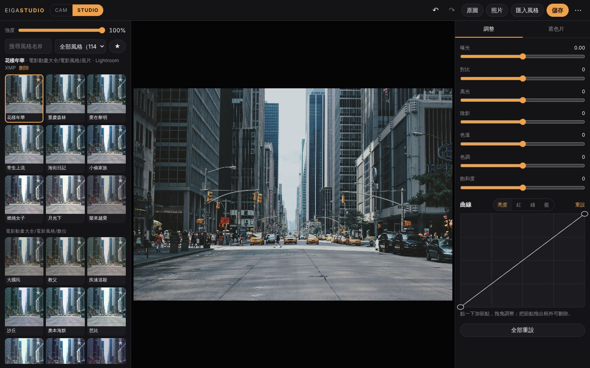
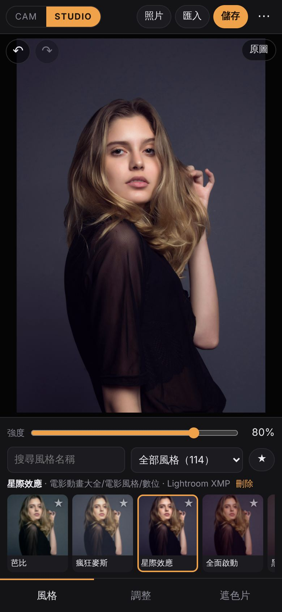
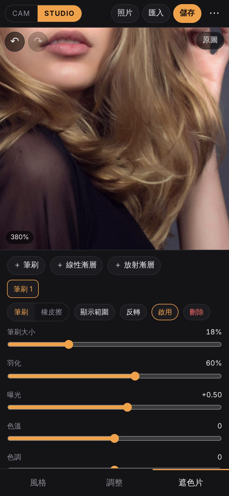
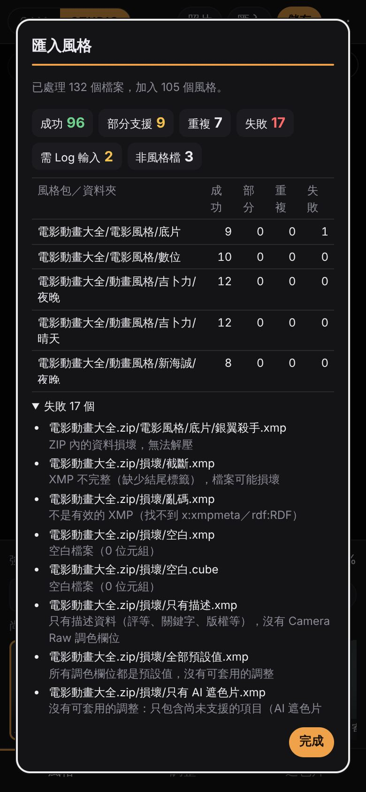

# EIGASTUDIO · 照片調色工作室

EIGACAM 的 Studio 模式：整包匯入 Lightroom 預設、.cube LUT 與 eigacam 配方，用自己的照片挑色、調整強度、做全圖與局部調整，再以原圖解析度存回裝置。所有運算都在瀏覽器本機完成，照片與風格不會上傳。

- 網站位置：`dist/eigastudio/`，與 CAM 一起由 GitHub Pages 部署（合併到 `main` 後的網址是 `https://bbcode1111.github.io/eigacam/eigastudio/`）。
- CAM 右上角有「STUDIO」連結；Studio 左上角的 CAM／STUDIO 切換可以回到相機。



| 手機：挑色 | 手機：遮色片 | 匯入報告 |
|---|---|---|
|  |  |  |

## 啟動與測試

不需要建置或安裝套件。

```sh
python3 -m http.server 8766        # 開啟 http://localhost:8766/dist/eigastudio/
node --test tests/*.test.mjs       # 單元測試（含 Studio 的匯入、XMP、.cube、配方）
node tests/studio-fixtures.mjs eigastudio-test-pack.zip   # 產生 134 個檔案的驗收測試包
node tests/studio-e2e.mjs          # 瀏覽器驗收（需要 Playwright 與 Chromium，伺服器要先開著）
```

## 使用流程

1. **照片**：選一張 JPEG 或 PNG（瀏覽器能解碼的 HEIC／WebP 也可以）。
2. **匯入風格**：手機可一次選多個檔案，或只選一個 ZIP；桌機另外可以把檔案、資料夾或 ZIP 拖進視窗，或從「⋯ → 匯入整個資料夾」。ZIP 內各層資料夾都會讀取，並以「ZIP 名稱／資料夾路徑」分組。匯入完成後顯示成功、部分支援、重複、失敗的數量與每個檔案的原因。
3. **挑色**：每個縮圖都用目前的照片算出來。點縮圖看大圖，調「強度」，按住「原圖」比較（桌機鍵盤 `\`）。可以搜尋名稱、依風格包篩選、按 ★ 收藏。
4. **調整**：曝光、對比、高光、陰影、色溫、色調、飽和度與曲線（亮度與 RGB 各通道）。
5. **遮色片**：筆刷與橡皮擦、線性漸層、放射漸層，最多 8 個；各有曝光、色溫、色調、飽和度、對比，可調大小與羽化、反轉、停用，「顯示範圍」以紅色覆蓋標出選取區。筆刷模式下單指繪製、雙指縮放移動；桌機用滾輪縮放。
6. **儲存**：以原圖重新運算成 JPEG。支援 Web Share 的手機會出現「分享／儲存到相簿」，其他情況用「下載」。
7. **⋯ 選單**：批次調色（目前的風格與調整套到多張照片，輸出 ZIP 或分享）、匯出／還原風格庫、格式相容表、刪除風格包。

風格庫、收藏、上一張照片與編輯狀態存在這台裝置的 IndexedDB，重新整理或關掉再開都還在。「匯出風格庫」會產生一個 ZIP（原始檔＋清單），在另一台裝置用「匯入風格」選它即可還原分組、名稱與收藏。

## 沿用 EIGACAM 的部分

| 現有模組 | 在 Studio 的用途 |
|---|---|
| `dist/src/color.js` | OKLab 色彩模型、`bakeLook`、對數 shaper、`pointCurve`。eigacam 配方直接用它烘焙成同一張 3D LUT |
| `dist/src/looks.js` | 9 個內建色彩，在風格庫顯示為「EIGACAM 內建」 |
| `dist/src/masks.js` | 遮色片資料格式與驗證；Studio 在同一格式上加了筆刷類型 |
| `dist/src/engine/shaders.js` | 遮色片選取、局部調整、LUT 取樣、暗角與顆粒的 GLSL 照原樣沿用到 `eigastudio/src/engine.js` |
| `dist/src/files.js` | 照片解碼（含 EXIF 方向）、JPEG 編碼、下載 |
| `dist/src/photo-delivery.js` | 手機系統分享／儲存 |
| localStorage `eigacam.recipes`、`eigacam.imports` | 在 CAM 存的配方與匯入的 XMP 會自動出現在 Studio（同一網域） |

沒有沿用的部分：CAM 的光暈、柔焦、膚色獨立渲染、美肌需要多重模糊流程，Studio 第一版不做，匯入這類配方時會標示「部分支援」。`color.js` 的 `lightroomTransform` 在零設定時仍會壓高光，所以 Studio 另寫 `lr.js`，保證所有欄位為 0 時是完全的恆等轉換。

備註：需求裡提到的 `presets.js`、`model.js`、`curves.js` 在這個專案裡不存在，對應的實際檔案是 `looks.js`、`color.js`（曲線在 `color.js` 的 `pointCurve`）。

## 開源依賴

| 專案 | 版本 | 授權 | 用途與引入量 | 來源 |
|---|---|---|---|---|
| fflate | 0.8.3 | MIT | ZIP 串流解壓、風格庫與批次輸出的 ZIP、IndexedDB 內的 deflate。整個 ESM 瀏覽器版放在 `dist/eigastudio/vendor/fflate.js`（91 KB 未壓縮） | npm `fflate@0.8.3` 的 `esm/browser.js` |
| Tabler Icons | 既有 | MIT | CAM 原有的圖示，Studio 沒有新增 | `dist/assets/icons/` |

評估後沒有引入的：

- **Three.js `LUTCubeLoader`（MIT，r180）**：解析本身約 60 行，但它產生 `Data3DTexture`，要連同 Three.js 核心一起載入。參考它的行為（`LUT_3D_SIZE`、`DOMAIN_MIN/MAX`、紅色最快的順序）後自己寫了 `cube.js`，另外補上 `LUT_3D_INPUT_RANGE`、損壞檔的錯誤訊息、超過 65³ 重新取樣與 Log 輸入判斷。
- **darktable `src/develop/lightroom.c`（GPL-3.0）**：只參考它選擇匯入哪些欄位（曝光、黑色、暗角、顆粒、參數曲線、HSL、分離色調、清晰度、點曲線）以及「能對應的才轉、其他略過」的做法，沒有複製程式碼。
- **JSZip／zip.js**：fflate 較小且有串流解壓，可以逐檔處理而不必把整包解到記憶體。

瀏覽器需求：WebGL2、IndexedDB、ES modules（Safari 15+、Chrome／Edge 90+、Firefox 90+）。

## 格式相容表

Lightroom 的運算是 Adobe 專有的，而且預設是為 RAW 設計；這裡把欄位換算成對已顯影的 JPEG／PNG 合理的結果，不是逐像素重現。App 內「⋯ → 格式相容表」顯示的是同一份資料（`xmp.js` 的 `XMP_FIELDS`）。

### Lightroom .xmp

| 項目 | 狀態 | 欄位（crs:） | 說明 |
|---|---|---|---|
| 曲線（點曲線，含 RGB 各通道） | 已實作 | `ToneCurvePV2012` `ToneCurvePV2012Red` `ToneCurvePV2012Green` `ToneCurvePV2012Blue` | 節點照原值套用；節點間用保形三次插值，與 Adobe 的樣條略有差異 |
| 飽和度 | 已實作 | `Saturation` | 以亮度為軸的線性飽和度 |
| 黑白 | 已實作 | `ConvertToGrayscale` `Treatment` | Rec.709 亮度轉灰階 |
| 曝光 | 近似轉換 | `Exposure2012` | 線性光 ×2^EV，正值加高光滾降 |
| 對比 | 近似轉換 | `Contrast2012` | 以中灰為支點的 S 曲線 |
| 高光／陰影 | 近似轉換 | `Highlights2012` `Shadows2012` | 亮度區段加權，不含 Adobe 的局部色調對應 |
| 白色／黑色 | 近似轉換 | `Whites2012` `Blacks2012` |  |
| 色溫／色調（相對值） | 近似轉換 | `IncrementalTemperature` `IncrementalTint` | JPEG／PNG 用的相對白平衡 |
| 鮮豔度 | 近似轉換 | `Vibrance` | 低飽和顏色加得多，沒有膚色保護 |
| 色彩混合 HSL | 近似轉換 | `HueAdjustmentRed` `HueAdjustmentOrange` `HueAdjustmentYellow` `HueAdjustmentGreen` … | 八個色相帶線性內插 |
| 黑白混色 | 近似轉換 | `GrayMixerRed` `GrayMixerOrange` `GrayMixerYellow` `GrayMixerGreen` … |  |
| 顏色分級／分離色調 | 近似轉換 | `SplitToningShadowHue` `SplitToningShadowSaturation` `SplitToningHighlightHue` `SplitToningHighlightSaturation` … |  |
| 參數曲線（區段） | 近似轉換 | `ParametricShadows` `ParametricDarks` `ParametricLights` `ParametricHighlights` … |  |
| 去朦朧 | 近似轉換 | `Dehaze` | 以對比與飽和度模擬，沒有霧氣估計 |
| 暗角 | 近似轉換 | `PostCropVignetteAmount` | 只取數量；中點、圓度、羽化用固定值 |
| 顆粒 | 近似轉換 | `GrainAmount` `GrainSize` |  |
| 線性漸層／放射漸層遮色片 | 近似轉換 | `GradientBasedCorrections` `CircularGradientBasedCorrections` `MaskGroupBasedCorrections` | 轉成 Studio 遮色片：曝光、色溫、色調、飽和、對比、染色；放射漸層的旋轉角度忽略 |
| 清晰度／紋理 | 未支援 | `Clarity2012` `Texture` | 需要多尺度局部對比 |
| 絕對色溫／色調（Kelvin） | 未支援 | `Temperature` `Tint` | 只對 RAW 有意義；JPEG 沒有原始白平衡可換算 |
| 相機校正 | 未支援 | `ShadowTint` `RedHue` `RedSaturation` `GreenHue` … |  |
| Profile／Look 查色表 | 未支援 | `Look` `CameraProfile` `LookTable` `RGBTable` … | Adobe 專用編碼或外部 .dcp／profile，無法解碼 |
| AI 遮色片（主體、天空、背景、人物） | 未支援 | `Mask/Image` | 需要 Adobe 的影像辨識模型 |
| 筆刷遮色片、範圍遮色片、組合遮色片 | 未支援 | `PaintBasedCorrections` `Mask/Paint` `Mask/RangeMask` |  |
| 點顏色、鏡頭模糊、修復 | 未支援 | `PointColors` `LensBlur` `RetouchInfo` `RetouchAreas` |  |
| 舊版處理版本的色調欄位 | 未支援 | `Exposure` `Brightness` `Contrast` `Shadows` … | PV2010 以前；請在 Lightroom 更新處理版本後重新匯出 |
| 銳利化、雜訊、鏡頭校正、裁切、幾何 | 略過（不提示） | `Sharpness` `LuminanceSmoothing` `ColorNoiseReduction` `LensProfileEnable` … | 不屬於調色，匯入時略過且不提示 |

辨識規則：

- **只有描述資料**（沒有任何 `crs:` 欄位）→ 失敗，不計入成功。
- **所有調色欄位都是預設值**，或**只含未支援項目**（例如只有 AI 遮色片、只有 profile 查色表）→ 失敗，並說明原因。
- **相片 sidecar**（有 `crs:RawFileName` 或 EXIF／TIFF 拍攝資料、沒有 `crs:PresetType`）→ 取用其中的調色設定，標示部分支援。
- **依賴外部或內嵌 profile**、**AI 遮色片**、清晰度／紋理、相機校正、絕對色溫 → 其餘欄位照常套用，標示部分支援並列出忽略了什麼。

### .cube 3D LUT

| 項目 | 狀態 | 說明 |
|---|---|---|
| `LUT_3D_SIZE` 2–65 | 已實作 | 紅色最快的格點順序，直接對應 WebGL 3D 貼圖；GPU 三線性內插。66–256 會重新取樣為 65³ |
| `DOMAIN_MIN`／`DOMAIN_MAX`、`LUT_3D_INPUT_RANGE` | 已實作 | 輸入（sRGB 編碼值）先依範圍正規化 |
| `TITLE`、註解、未知關鍵字 | 已實作 | 略過未知關鍵字；BOM 與 CRLF 可讀 |
| 需要相機 Log 輸入的 LUT | 可匯入，標示「Log」 | 依檔名、TITLE、註解判斷機型（S-Log、LogC、V-Log、F-Log、N-Log、Canon Log、D-Log、BMD Film、Log3G10、Apple Log、ACES、HLG／PQ），找不到標示時再依內容判斷「疑似 Log」。縮圖有 Log 徽章，選用時說明適用條件 |
| `LUT_IN_VIDEO_RANGE` | 近似 | 以全範圍套用並提示 |
| `LUT_1D_SIZE`、.3dl、.look、.mga | 未支援 | |

### eigacam 配方

| 項目 | 狀態 | 說明 |
|---|---|---|
| `looks.js` 的色彩物件（gain、hues、tone、print、shadows、highlights、mono 或 `lr`） | 已實作 | JSON 檔可放單一物件、陣列、`{looks:[…]}` 或 `{recipes:[…]}` |
| CAM 的使用者配方 `{id, name, base, masks}` | 已實作 | `base` 須是內建色彩的 id |
| 遮色片（漸層、圓形、明暗、顏色）、暗角、顆粒 | 已實作 | 遮色片強度跟著「強度」滑桿 |
| 光暈、柔焦、膚色獨立渲染、光影強調、局部柔化、銳利化 | 未支援 | 標示部分支援 |

## 驗證紀錄

### 已實際驗證（2026-11-14）

環境：這個雲端容器裡的**無頭 Chromium（Playwright）＋ SwiftShader 軟體 WebGL2**。桌面瀏覽器項目是 1440×900 視窗加滑鼠事件；「手機尺寸」項目是 390×844、DPR 2、iPhone UA 加觸控事件的**模擬**，不是實機。

| 項目 | 結果 |
|---|---|
| 整包匯入 | 134 個檔案（含子資料夾 17 個分組）→ 成功 96、部分 9、重複 7、失敗 17、非風格檔 3、Log 2；1773 ms |
| 重複匯入同一包 | 新增 0、重複 112 |
| 縮圖只算看得到的 | 115 個縮圖中先算 20 個，各不相同 |
| 切換風格不疊色 | A→B→C→B→A 後與第一次的 A 逐像素相同（差 0） |
| 強度 | 0% 與未套用風格逐像素相同；50% 介於兩者之間；回到 100% 與原本相同 |
| 換第二張照片 | 20 個可見縮圖全部重算且與第一張不同；風格庫 105 個與收藏 2 個保留；不疊色、0% 還原同樣成立 |
| 搜尋、風格包篩選、收藏 | 搜尋「之」9 個；LUT 包 30 個；只看收藏 2 個 |
| 重開網站 | 風格 105 個、收藏 2 個、上次的照片與選用的風格都還在 |
| 風格庫匯出再還原 | 備份 176 KB；清空後還原 105 個風格，分組、名稱與 2 個收藏完全一致 |
| 實際 XMP 預設 | dist/presets/EIGACAM-Neon-Rain.xmp：部分支援（忽略清晰度／紋理），已套在 street.jpg 上截圖 |
| eigacam 配方相容 | 與 CAM 自己的著色器逐像素比對（關閉 CAM 專用效果）：loveletter-snow 最大差 1/255、transformer 最大差 1/255、neonrain 最大差 1/255 |
| 臉部刷亮半級 | 臉部線性亮度 ×1.414（+0.5 EV 理論值 ×1.414）；背景 ×1.000 |
| 縮放後筆刷跟手 | 放大到 255% 後在手部下筆，該處 ×1.371；臉部維持不變 |
| 復原與重做 | 復原移除最後一筆，重做後恢復 |
| 匯出位置一致 | 匯出 2400×3600（預覽 1365×2048）；同位置：臉 ×1.412、背景 ×1.000、手 ×1.370；下載 portrait-eigastudio.jpg 1.03 MB |
| 線性／放射漸層、反轉、多個遮色片 | 線性 −1 EV：上緣 ×0.50、下緣 ×1.00，反轉後對調；放射遮色片中心去飽和；共 3 個遮色片並存 |
| 全圖調整與曲線 | 曝光 +1 → 線性 ×1.99；飽和度 −100 → 灰階；色溫 +60 → 偏暖；曲線中點上拉後畫面變亮 |
| 手機尺寸：選照片 → 匯入 ZIP → 滑動挑色 | 橫向滑過風格列（捲動 1611px），同時存在的縮圖 12/115；點選後套用並調強度 80% |
| 手機尺寸：手指局部調整 | 臉 ×1.414、背景 ×1.000；雙指放大到 380% 不會誤畫；放大後在手部下筆 ×1.370 |
| 手機尺寸：儲存 | 2400 × 3600 · 1.0 MB · JPEG 92%；下載 portrait-eigastudio.jpg；系統分享按鈕未出現（無頭 Chromium 沒有 Web Share，需實機確認） |

測試包內容（`tests/studio-fixtures.mjs`）：134 個檔案、17 個資料夾分組，含 60 個 XMP、30 個 .cube、3 個 eigacam JSON、7 個部分支援、8 個位元組完全相同的重複檔、3 個同名不同內容、16 個損壞或無可套用調整的檔案、1 個在 ZIP 內被破壞壓縮資料的項目、3 個非風格檔與 2 個 macOS 殘留檔。每個檔案都帶著預期結果，匯入報告與預期逐項核對。

另有 `tests/studio.test.mjs` 15 項單元測試：零設定恆等、各滑桿方向與單調性、曲線節點、`.cube` 格點順序、Log 判斷的誤判（Analog、Catalog 不會被當成 Log）、9 個內建色彩與 CAM 的 LUT 逐值相同、備份還原。

### 尚未驗證

- **手機實機**（iOS Safari、Android Chrome）：完全沒有測過。需要確認的有：一次選取多個 `.xmp`／`.cube` 檔時系統檔案選擇器不會把它們反灰、「分享／儲存到相簿」按鈕出現並能存進相簿、1200 萬畫素照片匯出時的記憶體、真實 GPU 上的效能、加入主畫面後離線開啟。
- **桌面實機瀏覽器**（Safari、Firefox、有 GPU 的 Chrome）：只在無頭 Chromium 跑過。拖放資料夾的程式路徑沒有自動化測試。
- **與 Adobe 的輸出比對**：這裡沒有 Lightroom，XMP 換算只驗證了方向、數學性質與實際畫面截圖，沒有和 Lightroom 匯出的同一張照片比對色差。
- **真實的商業風格包**：測試包是程式產生的。實際的預設包可能有這裡沒涵蓋的寫法（例如元素形式的局部調整、非 UTF-8 檔名的 ZIP）。
- **XMP 局部調整的座標慣例**：線性／放射漸層的換算依欄位名稱（Full／Zero、Top／Left／Bottom／Right、`LocalExposure2012`×4）實作，未用 Lightroom 匯出的檔案驗證。
- 上百個 65³ LUT 的大型風格庫的儲存用量與速度。

### 已知限制

- 預覽最長邊 2048px（手機 1440px）；放大檢視時看到的是放大的預覽，匯出才是原圖解析度。
- 筆刷遮色片以最長邊 1024px 儲存，匯出時放大取樣；細小的筆觸邊緣會比預覽柔一些。
- 換照片會清除全圖調整與遮色片，保留選用的風格與強度。
- 縮圖只顯示風格本身，不含目前的全圖調整。
- 沒有裁切、旋轉、RAW 與影片。Studio 的風格目前不能反向送回 CAM 當取景濾鏡。
- ZIP 內的 ZIP 不會展開；加密的 ZIP 會被回報為損壞。
